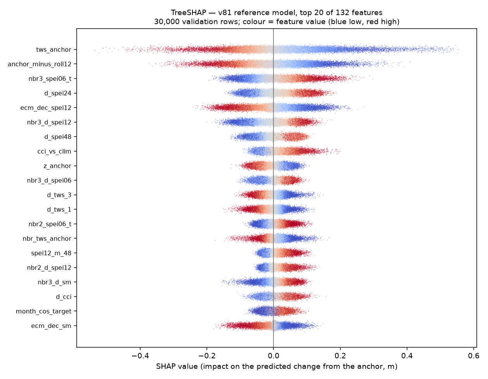

# Forecasting Global Water Storage — final submission

**`submission.csv` — public leaderboard RMSE 0.662803625**

A minimum-variance blend of six models, shrunk toward a persistence anchor:

```
submission = persistence + γ · ( Σ wᵢ · modelᵢ  −  persistence )
```

Neither the weights `wᵢ` nor the shrinkage `γ` is tuned by trial and error on the
leaderboard — both are solved in closed form from the member predictions and their already
published scores.

### Rebuilding the submission

```bash
pip install -r requirements.txt
python blend/make_persistence.py  --data <competition CSVs>    # the shrinkage anchor
python blend/make_final_blends.py --data <competition CSVs>    # -> submission.csv
```

`make_final_blends.py` re-derives the weights and γ from the member predictions and their
published scores, then writes the submission. It trains nothing — it combines the member
CSVs in `predictions/`.

To verify end to end rather than trusting the shipped predictions, retrain the members
from `members/` and compare each fresh output against `predictions/`, then blend the
retrained outputs and compare against `submission.csv`. Training is about 12.3 h in total,
so it spans more than one Kaggle session.

---

## 1. The solution

| member | public LB | weight | what it is |
|---|---|---|---|
| `xgb_v60_recurse` | 0.685562412 | 0.2154 | **Recursive**: 3 stages, each retrained on the previous stage's predictions as pseudo-labels; inference steps month-by-month, refilling the TWS panel between months |
| `xgb_v85_level_hl96` | 0.672036642 | 0.1955 | Predicts the target **level** rather than the change from the anchor |
| `xgb_v87_storage_hl96` | 0.672415764 | 0.1830 | v81 + 4 modelled-storage columns (ERA5-Land soil column and snow, as anomalies against an as-of climatology and as anchor→t changes) |
| `realmlp_v72_e15` | 0.695636003 | 0.1779 | RealMLP-TD neural network, `n_epochs=15` pinned, early stopping off |
| `xgb_v81_recency_hl96` | 0.670554680 | 0.1611 | XGBoost, 132 features, change-from-anchor target, 5 seeds × 802 rounds; refit weights rows by recency, half-life 96 months |
| `xgb_v32_era5` | 0.677796328 | 0.0672 | XGBoost, an earlier ERA5-Land feature generation |
| | | **γ = 0.9670** | shrinkage toward `persistence` (LB 0.886420231) |

**Members are chosen for decorrelation, not accuracy.** The two *weakest* models by RMSE —
`v60_recurse` and `realmlp_v72_e15` — carry the largest and fourth-largest weights, more
than the best single model's 0.161. A blend gains from members whose *errors* differ; a more
accurate model predicting nearly the same thing adds nothing.

### Where each member was trained

Each member is shipped as the artefact that actually produced it, not a later re-run.

| member | platform | producing artefact |
|---|---|---|
| `xgb_v81_recency_hl96` | Kaggle CPU | `members/kaggle_v81_recency_deep.ipynb` |
| `xgb_v85_level_hl96` | Kaggle CPU | `members/kaggle_v85_level_deep.ipynb` |
| `xgb_v87_storage_hl96` | Kaggle CPU | `members/kaggle_v87_storage_deep.ipynb` |
| `xgb_v60_recurse` | Kaggle CPU | `members/kaggle_v60_recurse_deep.ipynb` |
| `realmlp_v72_e15` | Kaggle CPU | `members/kaggle_v72_realmlp_e15.ipynb` — training recorded at [version 17](https://www.kaggle.com/code/lastopt/fgws25?scriptVersionId=347420311) |
| **`xgb_v32_era5`** | **local (this machine, CPU)** | `members/sub_xgb_v32_era5.py` |

Five of the six ran on Kaggle. `xgb_v32_era5` is the exception and was trained locally; its
run log is at `provenance/emissions/runlog_v32_era5.log`, and it is the only log in the
project that writes a blend member. Both it and the five notebooks are shipped byte-for-byte
as they were run.

Supporting experiment record on Kaggle: <https://www.kaggle.com/code/lastopt/fgws25>

The RealMLP member's training run is recorded at a pinned version of that notebook —
<https://www.kaggle.com/code/lastopt/fgws25?scriptVersionId=347420311> (version 17) — which
matters more for this member than for the others: it is the only one trained with torch
rather than XGBoost, and torch on CPU is not bit-identical across thread counts, so a
recorded execution is the strongest evidence available for it. Expect a rerun to agree with
`predictions/realmlp_v72_e15.csv` to a few decimals rather than to machine precision.

### How the weights are obtained

Two submissions differ exactly by the difference of their errors (`pᵢ − pⱼ = eᵢ − eⱼ`), so the
error covariance is recoverable from the submission files and published scores alone:

```
cov(eᵢ, eⱼ) = ( sᵢ² + sⱼ² − mean((pᵢ − pⱼ)²) ) / 2
```

Minimum-variance weights follow as `w = Σ⁻¹1 / (1ᵀΣ⁻¹1)`, clipped non-negative. Shrinkage
uses the same identity: with `A = s²persistence`, `C = mean((blend − anchor)²)` and `B` pinned
by `MSE(γ=1) = s²blend`, `MSE(γ) = A + 2γB + γ²C` and `γ* = −B/C`. Back-solving γ from the
*measured* score of the submitted file returns 0.9667 against the 0.9670 shipped — a
difference worth 0.000000, so the shrinkage sits at its optimum.

The method forecast this submission at 0.662660 against an actual **0.662803625**, an error
of +0.000144, before it was submitted.

---

## 2. Data

### Provided
`Train.csv`, `Test.csv`, `SampleSubmission.csv` — GRACE/GRACE-FO terrestrial water storage
anomalies, 1° grid, 15,715 land cells. Train 2002-05…2015-08 (138 months), test
2015-09…2018-12 (18 months), strictly sequential, no overlap. Covariates: `TWS_t`,
`SPEI_01/03/06/12_t`, `SOIL_MOISTURE_t`, `month_sin`, `month_cos`.

### External — all permitted, see §4

| dataset | source | used | built by |
|---|---|---|---|
| **ERA5-Land monthly means** | Copernicus CDS `reanalysis-era5-land-monthly-means`, DOI 10.24381/cds.68d2bb30 | `tp`, `e`, `sro`, `ssro`, `swvl1-4`, `sd`, `smlt`, `t2m`, `sf`, `stl1`, `stl4`, `snowc`, `pev`; 2002–2018, 0.25° (snow at native 0.1°) | `data_prep/era5_fetch.py` → `era5_grid.py` |
| **ESA CCI satellite soil moisture** | Copernicus CDS `satellite-soil-moisture` | `cci_rz1m` (root zone 0–100 cm), `cci_ssm` (surface) as fallback | `data_prep/cci_fetch.py` → `cci_grid.py` |
| **CDS drought indices** | Copernicus CDS `derived-drought-historical-monthly` | SPEI at 12, 24, 48-month windows | `data_prep/drought_fetch.py` → `drought_grid.py` |

All are regridded onto the competition's own 1° / 15,715-cell grid by land-area averaging.
ERA5-Land is used as the **final (retrospective) product**, permitted as the proxy for ERA5T
in historical validation. Per-download request, byte count, SHA-256 and UTC timestamp are in
`provenance/era5_provenance.jsonl`.

---

## 3. Reproducing

**What is not in this package, and why.** Three things must be supplied:

| needed | size | where from |
|---|---|---|
| `Train.csv`, `Test.csv`, `SampleSubmission.csv` | ~315 MB | the competition; redistributing them here is not ours to do |
| `era5_grid.parquet`, `cci_grid.parquet`, `drought_grid.parquet` | ~340 MB | rebuilt by `data_prep/` from Copernicus CDS (step 1) |
| a Copernicus CDS account and API key | — | free registration, needed only for step 1 |

Scripts take `--data DIR` for the competition CSVs, or read `$GWS_DATA`; both default to
`./data/raw`. Everything else — member predictions and the anchor — is included, so **step 2 can be
skipped** and the submission rebuilt from what is here:

```bash
python blend/make_final_blends.py --data <competition CSVs>
```

1. **External data** (needs a Copernicus CDS account):
   ```bash
   python data_prep/era5_fetch.py --grid 0.25
   python data_prep/era5_grid.py --src data/era5/nc_0p25_core --out data/era5_grid.parquet --rates
   python data_prep/cci_fetch.py     && python data_prep/cci_grid.py
   python data_prep/drought_fetch.py && python data_prep/drought_grid.py
   ```
2. **Members** — each artefact in `members/` is self-contained and CPU-only, and writes one
   member CSV. The five Kaggle notebooks run as they are; `xgb_v32_era5` is a script and was
   trained locally (`python members/sub_xgb_v32_era5.py`, 117.8 min, run log in
   `provenance/emissions/runlog_v32_era5.log`).

   The five XGBoost members pin `xgboost==3.2.0`, checked via `importlib.metadata` *before*
   xgboost is imported — pip-installing after the C extension has loaded does not swap it,
   so an install-then-reload would silently keep the old build. The RealMLP member pins
   `pytabkit==1.5.0`.

   ⚠️ **Provenance caveat on `xgb_v32_era5`.** Its script's last modification is dated two
   days after the run that produced the shipped CSV. It is unmistakably the right script —
   it writes that exact filename, and the run log matches its structure and its reported
   validation RMSE of 0.6044 — but byte-level correspondence with what executed cannot be
   asserted without re-running it. The other five were checked the same way and are clean:
   each CSV postdates its notebook by roughly the recorded runtime.
3. **Blend**:
   ```bash
   python blend/make_persistence.py     # the shrinkage anchor
   python blend/make_final_blends.py    # the submission
   ```

**Determinism.** Every member is CPU-only with a pinned library version. GPU was deliberately
avoided: it scores slightly better here and emits less, but CPU and GPU XGBoost produce
different models from identical inputs, and reproducibility was judged the higher value.

---

## 4. Compliance

- **No GRACE-derived external data at any date** — no TWSA product, mascon solution, or
  GRACE-trained reconstruction (GTWS-MLrec, GRAiCE). `data_prep/era5_fetch.py` refuses such
  requests by dataset name *and* variable name at runtime.
- **No feature reads month t+1 or later**, proven empirically rather than argued.
  `provenance/leak_test.py` corrupts every input — both competition CSVs and all three
  parquets — at every month after a cutoff, first to NaN then to a large constant, rebuilds
  the feature panel and asserts bit-identical features. It is runnable as shipped:
  ```bash
  python provenance/leak_test.py --data-root=/path/to/project     # 132/132
  ```
  `--data-root` (or `$GWS_ROOT`) must contain `data/raw/*.csv` and the three parquets under
  `data/`. It runs against `members/sub_xgb_v32_era5.py`, the one member that exists as an
  importable script; the other five are notebooks. Nothing in `members/` is modified — the
  member scripts resolve their own project root at import time, so the test loads the module
  from a temporary scaffold rather than editing it.

  **Both architectures were verified this way during development** — the deepest
  gradient-boosted member at 136/136 and the RealMLP member at 132/132. That distinction
  matters: RealMLP builds its panel with its own `class P` and `train_rows`, and only its
  `features()` is byte-identical to the gradient-boosted reference, so a proof on one does
  not imply the other.
- **Coordinates are a lookup key only**, used to sample external grids at each cell, never a
  feature. The leak test also asserts no feature name is coordinate-derived.
- `provenance/host_ruling_2026-09-04_gldas.md` reproduces verbatim a host clarification from
  the competition forum permitting non-GRACE land-surface-model variables with source dates
  ≤ t. It is not in the written guidelines, so it is quoted rather than cited.

---

## 5. Where the error is

Error is uneven across the grid and the year, so we report it sliced rather than pooled
(`provenance/bias_slices_v81.csv`).

**By region**, the southern extratropics are both the worst band and the only one with a
large systematic offset — RMSE 0.671 against the northern midlatitudes' 0.561, and a mean
error of **−0.215**. They are also the thinnest slice, 10,807 validation rows against
107,424, simply because there is little land at those latitudes. The imbalance follows from
the geography and we have not corrected for it.

**By season**, March (0.799) and July (0.737) together carry 35% of the loss, against ~0.50
in the calmest months; snowmelt onset and monsoon onset are the hard regimes.

**By event size**, RMSE runs from 0.347 on the smallest storage changes to 1.530 on the
largest. The model is weakest on exactly the events that would matter most operationally.

We did not use a fairness toolkit such as AI Fairness 360 — those target
protected-attribute classification, and this is a gridded regression with no protected
attributes; the meaningful axes here are geographic, seasonal and magnitude, measured above.

## 6. What drives the predictions



TreeSHAP — exact for tree ensembles rather than sampled — over 30,000 validation rows of
v81, the architecture four of the six members share. Full ranking in
`provenance/shap_values_v81.csv`.

No single feature dominates: the strongest, `tws_anchor` (the last observed storage), is
7.9% of mean |SHAP|, and the top twelve together are 41%.

The result we did not expect is that SPEI **changes** outrank SPEI **levels**. `d_spei24`
(4.1%) and `d_spei48` (3.0%) both beat the raw indices, and a *neighbour-cell* index,
`nbr3_spei06_t` (4.7%), ranks third overall. A plausible reading: 66.5% of test rows have
their TWS masked, so the model is bridging a window it cannot observe, and what carries a
forecast across that window is how the drought state moved rather than where it currently
sits. This describes the model's behaviour, not the hydrology.

## 7. Adapting this to other problems

Lead time is a feature rather than a separate model, so one fit covers h=1…7 and extending
the horizon needs more rows, not new code. Location never enters as coordinates — only each
cell's own climatology, variance and trend — so the pipeline transfers to any gridded
monthly variable, such as soil moisture, groundwater or streamflow, by swapping the panel
source. External covariates all pass through a single regrid step onto the target grid, so
adding a dataset is one fetch script plus a column.

The binding assumption is a regular monthly grid with a usable observation history per cell.
Ungauged basins or irregular in-situ networks would need a different anchor definition
before any of this applies.

## 8. Compute and carbon

CodeCarbon wrapped every training run (`provenance/emissions/`): **0.275 kg CO₂e across ~12.3
hours**, CPU only.

Efficiency came from float32 panels, cumulative-sum statistics computed once per cell rather
than per row, `max_bin=127`, and training on 20% of the available row-horizon pairs — a
measured optimum rather than a shortcut. The blend itself trains nothing, so the final
0.0007 of score cost no additional compute at all.

The trade-off we accepted: GPU training scored slightly better here and emits less, but CPU
and GPU XGBoost produce different models from identical inputs, so we took reproducibility
over both.

| member | wall clock | kg CO₂e |
|---|---|---|
| `xgb_v60_recurse` | 246.7 min | 0.0202 |
| `xgb_v81_recency_hl96` | 167.7 min | 0.0138 |
| `xgb_v87_storage_hl96` | 84.7 min | 0.0225 |
| `realmlp_v72_e15` | 59.4 min | 0.0101 |
| `xgb_v32_era5` | 117.8 min | 0.0520 |
| `xgb_v85_level_hl96` | 58.2 min | 0.1566 |
| **total** | **~12.3 h** | **0.275** |

One anomaly to flag: `v85`'s 0.157 kg is a sevenfold outlier for a shorter run than several
others, which we attribute to the grid carbon intensity of whichever region the hosted
runtime used rather than to the model. `xgb_v32_era5` is the one member trained locally, so
its 0.052 kg is measured on this machine's grid rather than a data centre's and is not
directly comparable to the rest.

## 9. Notes on method

**Members were priced before they were submitted.** Since `pᵢ − pⱼ = eᵢ − eⱼ`, a candidate's
break-even against the current blend is `sⱼ < √(s_b² + d²)` with `d² = mean((pᵢ − pⱼ)²)`,
which follows without assuming anything about how the errors correlate. Each member was
admitted on that test rather than by submitting it and looking.

**The shrinkage was solved, not searched.** `MSE(γ) = A + 2γB + γ²C` has all three terms
measurable from the CSVs plus one published score. Back-solving γ from the measured result
afterwards returned 0.9667 against the 0.9670 used — a gap worth 0.000000.

**Validation was moved forward in time.** A conventional held-out split misleads on this
problem: it covers the 24 months straight after training, while the test period runs 1–40
months beyond. Screening candidates instead on a forward split — fit on months ≤ cut,
evaluate strictly after — reversed the ranking of several post-processing schemes. One
scheme worth −0.0054 on a random split came out at **+0.0004** forward and was dropped; a
random split would have shipped it.

## 10. Limitations

The model produces a point forecast with no uncertainty band. That is what RMSE rewards, but
an operational drought-response user would need intervals, and the error structure in §5
shows why: skill varies by a factor of four between the calmest cells and the largest
events, so a single global error figure would badly misrepresent confidence in either.

Skill also degrades with lead time, from RMSE 0.573 at one month to 0.638 at seven, while
the one-month lead carries 38.7% of the weighted loss.

## Files

```
submission.csv                      the scored submission (LB 0.662803625)
README.md                           this file
DOCUMENTATION.docx                  detailed solution document
requirements.txt                    pinned versions, every dependency
blend/
  make_final_blends.py              builds the submission from the six member CSVs
  make_persistence.py               rebuilds the shrinkage anchor
members/                            what produced each member (5 notebooks + 1 script)
predictions/                        the six member CSVs + the persistence anchor
data_prep/                          fetch + regrid for ERA5-Land, ESA CCI, CDS SPEI
provenance/
  leak_test.py                      empirical date-discipline proof (runnable, see §4)
  shap_summary_v81.png              TreeSHAP figure (§6)
  shap_values_v81.csv               mean |SHAP| for all 132 features
  bias_slices_v81.csv               error by latitude, lead time, event size, month (§5)
  era5_provenance.jsonl             per-download request, checksum, timestamp
  host_ruling_2026-09-04_gldas.md   host clarification on external model data
  emissions/                        CodeCarbon output and run metadata per member
```
